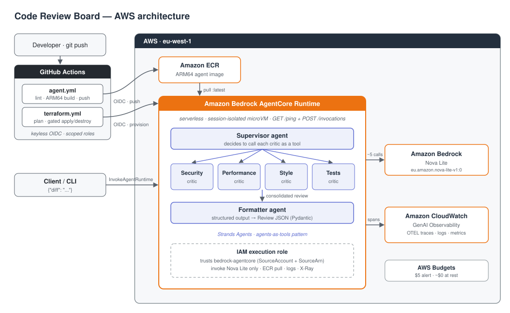
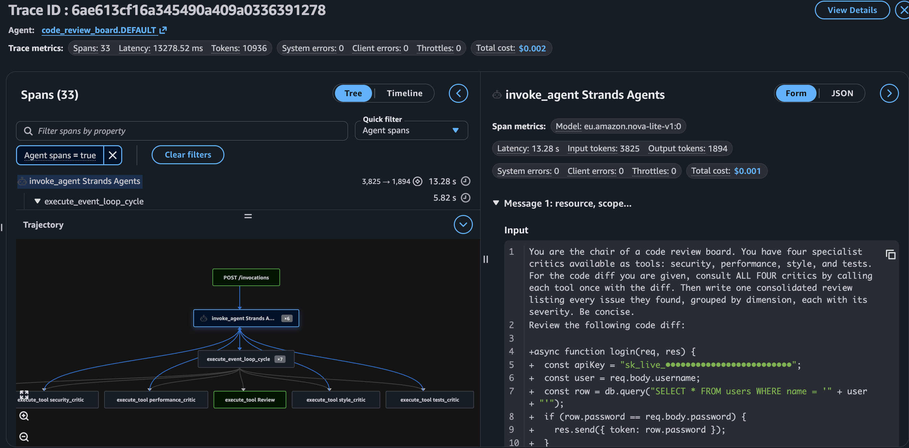

# Code Review Board

A **multi-agent code reviewer** on AWS: paste a diff and a panel of specialist AI critics — **Security, Performance, Style, and Tests** — review it in parallel, a **supervisor** agent consolidates their findings, and a **formatter** agent returns one structured JSON verdict. Built with the **Strands Agents SDK** on **Amazon Bedrock AgentCore Runtime** (Nova Lite), packaged as an ARM64 container, and shipped through a **keyless, gated GitHub Actions CI/CD** pipeline provisioned entirely with **Terraform**.

It costs ~$0 at rest: the runtime is deployed only to demo and then torn down with a single flag, so there is no agent server running when nobody's using it.

> **Why it exists:** a portfolio project to demonstrate *agentic AI* — multiple LLM agents collaborating — on AWS's newest managed agent platform (AgentCore), done the professional way: infrastructure-as-code, least-privilege IAM, OIDC, human-gated deploys, and end-to-end tracing.

---

## Architecture



<sub>Icons: [AWS Architecture Icons](https://aws.amazon.com/architecture/icons/) and GitHub [Primer Octicons](https://primer.style/octicons/) (MIT).</sub>

### Request flow

1. A client calls `InvokeAgentRuntime` with a payload: `{"diff": "<code diff>"}`.
2. **AgentCore Runtime** routes the request to the agent container (HTTP contract: `GET /ping` + `POST /invocations` on `0.0.0.0:8080`), isolating the session in its own microVM.
3. The **supervisor** agent is handed the diff with the four critics available **as tools**. It decides to call each one; every critic is itself a Strands `Agent` with a focused system prompt that invokes **Bedrock Nova Lite**.
4. The supervisor consolidates the critics' findings into one review; a tool-less **formatter** agent converts that prose into a strict `Review` schema (Pydantic) so the response is reliable JSON.
5. The structured verdict is returned over HTTP, and the whole supervisor → critics → formatter call tree is traced to **CloudWatch GenAI Observability**.

No credentials are stored anywhere: the agent authenticates to Bedrock with its IAM **execution role**, and CI/CD authenticates to AWS with **GitHub OIDC**.

> **Design note — why Runtime, not the Harness.** AgentCore's managed *Harness* runs a single agent loop from configuration. This project is deliberately multi-agent (a supervisor orchestrating critic *agents* as tools, plus a formatter stage), which the single-loop Harness doesn't model cleanly — so it's built on **Runtime with Strands** for explicit multi-agent control.

---

## Observability



One invocation traced end-to-end in CloudWatch GenAI Observability: the supervisor span fans out to each critic's Nova Lite call, then the formatter produces the structured verdict. Spans come from OpenTelemetry auto-instrumentation (`opentelemetry-instrument` + `aws-opentelemetry-distro`) exporting to the endpoint AgentCore injects into the container.

---

## The agentic pattern

This is the "**agents-as-tools**" multi-agent pattern:

- Each **critic** is a full `Agent` (its own model + system prompt) wrapped with `@tool`. Its docstring tells the supervisor *when* to use it.
- The **supervisor** is an `Agent` given `tools=[security_critic, performance_critic, style_critic, tests_critic]`. It isn't hard-coded to call them in order — **the model decides** to consult each one. That decision-making is the "agentic" part.
- The **formatter** is a separate, tool-less `Agent` that produces **structured output** (`structured_output_model=Review`), so downstream code gets clean JSON instead of prose.

One `/invocations` call fans out into ~5 Nova Lite calls and folds the results back into a single verdict.

---

## Tech stack

| Area | Services & tools |
|------|------------------|
| **Agents** | [Strands Agents SDK](https://strandsagents.com/) (Python) — agents-as-tools, supervisor pattern, Pydantic structured output |
| **AI inference** | Amazon Bedrock — Amazon Nova Lite (`eu.amazon.nova-lite-v1:0` inference profile) |
| **Agent hosting** | Amazon Bedrock **AgentCore Runtime** — serverless, session-isolated, ARM64 containers |
| **Packaging** | Docker (`linux/arm64`), `uv` (deps + lockfile), Amazon ECR |
| **Observability** | CloudWatch **GenAI Observability** via OpenTelemetry (`aws-opentelemetry-distro` + `opentelemetry-instrument`), Transaction Search |
| **Identity** | AWS IAM + GitHub OIDC (keyless), least-privilege scoped roles, confused-deputy–guarded trust |
| **IaC** | Terraform (`hashicorp/aws`), native `aws_bedrockagentcore_agent_runtime`, S3 backend with native locking |
| **CI/CD** | GitHub Actions — lint + ARM64 build/push to ECR; Terraform plan on PRs, **gated** apply/destroy via a protected Environment |
| **Cost control** | `deploy_runtime` flag (up/down on demand), short idle-session timeout, ECR lifecycle policy, AWS Budgets |

---

## What we built, step by step

| Phase | What | Key services / tools |
|-------|------|----------------------|
| **1** | One agent → Nova Lite through Strands (prove Bedrock reachability) | Strands, Bedrock |
| **2** | The critic panel: four `@tool` critic agents + supervisor + structured-output formatter | Strands, Pydantic |
| **3** | Wrap the board in the AgentCore Runtime HTTP contract (`BedrockAgentCoreApp`) | `bedrock-agentcore` SDK |
| **4** | Containerize for `linux/arm64`, build with buildx, verify locally via `/ping` + `/invocations` | Docker, uv |
| **5** | Terraform foundation (reuse Project 1's state bucket + OIDC provider) | Terraform, S3, IAM |
| **6** | Terraform resources: ECR, least-privilege runtime execution role, the AgentCore Runtime | Terraform, ECR, IAM, AgentCore |
| **7** | Keyless gated CI/CD: lint/build/push + plan→gated apply→gated destroy; three scoped CI roles | GitHub Actions, OIDC |
| **8** | Deploy through the pipeline, invoke with real diffs, add OpenTelemetry tracing | AgentCore, CloudWatch |
| **9** | This README + architecture diagram | — |

---

## Security highlights

- **No long-lived credentials anywhere.** Local work uses AWS SSO; CI/CD uses GitHub **OIDC** to assume scoped roles.
- **Least-privilege IAM.** Separate CI roles for *plan* (read-only), *apply* (write, enumerated actions scoped to this project's own resources), and *deploy* (push to the one ECR repo only).
- **Confused-deputy–guarded execution role.** The runtime role trusts `bedrock-agentcore.amazonaws.com` only with `aws:SourceAccount` + `aws:SourceArn` conditions, and may invoke **only Nova Lite**.
- **Human-gated infra changes.** `terraform apply` and `destroy` run only after approval in a protected GitHub Environment.
- **Session isolation.** AgentCore runs each session in its own microVM.

---

## Cost

Designed to run on a budget AWS account, **~$0 at rest**:

- **AgentCore Runtime** — the only meaningful cost, billed for memory while a session is alive; a short idle timeout reclaims it, and the `deploy_runtime=false` flag drops it entirely between demos.
- **Bedrock Nova Lite** — pay per token, only when invoked; a review is a few cents at most.
- **ECR / CloudWatch logs + traces** — a few cents/month; removed on full teardown.
- **IAM roles, service-linked role, S3 state** — free.
- A monthly **AWS Budget** backstops everything at $5.

> Up/down on demand: `apply` with `deploy_runtime=true` to demo, `deploy_runtime=false` (or `destroy`) to return to ~$0.

---

## Repository layout

```
CodeReviewBoard/
├── agent/                   # the Strands app (Python)
│   ├── board/
│   │   ├── model.py         # shared BedrockModel factory (Nova Lite)
│   │   ├── critics.py       # 4 @tool-wrapped critic agents
│   │   ├── schema.py        # Pydantic Finding / Review
│   │   ├── board.py         # supervisor + formatter + run_board()
│   │   └── runtime.py       # AgentCore entrypoint (BedrockAgentCoreApp)
│   ├── Dockerfile           # ARM64, opentelemetry-instrument wrapper
│   └── pyproject.toml       # uv-managed deps
├── infra/terraform/         # ECR, IAM, AgentCore Runtime, CI roles
└── docs/
```

Workflows live at the repo root under `.github/workflows/` (`agent.yml`, `terraform.yml`).

---

## Deploying it yourself

**Prerequisites:** an AWS account with Bedrock + AgentCore access, AWS CLI v2, Terraform ≥ 1.11, Docker, `uv`, and the GitHub CLI.

1. **Bootstrap** `infra/terraform` once locally (`terraform apply -var deploy_runtime=false`) to create ECR + the IAM/CI roles; set the repo secrets for the role ARNs and the ECR repo name.
2. **Create** the gated GitHub Environment and (one-time) the AgentCore runtime-identity **service-linked role**.
3. **Push** — PRs run `terraform plan` + lint; `agent.yml` builds/pushes the ARM64 image to ECR.
4. **Deploy** — run the Terraform workflow with `action=apply`, `deploy_runtime=true` (gated), then `InvokeAgentRuntime` with a diff.
5. **Tear down** — `deploy_runtime=false` to drop the runtime, or `action=destroy` for a full teardown.

---

## Notable problems solved

Real engineering friction, each a good story:

- **OIDC lookup needed account-wide `ListOpenIDConnectProviders`.** Looking up the reused OIDC provider by URL forced an un-scopable list permission; switching the data source to an **ARN lookup** used only the scoped `GetOpenIDConnectProvider` the role already had.
- **Creating a runtime does more than it looks.** `CreateAgentRuntime` also creates a default **endpoint** (needs `CreateAgentRuntimeEndpoint`) and, for any runtime since Oct 2025, an AgentCore **service-linked role** — created once out-of-band so the CI role never needs SLR-creation power.
- **Provider "inconsistent result" on `max_lifetime`.** AWS defaults the session `max_lifetime` to 28800s while the plan expected null; setting it explicitly resolved the mismatch.
- **Observability needs app instrumentation.** Enabling Transaction Search isn't enough — the container must emit OTEL spans. Wrapping the start command in `opentelemetry-instrument` (with `aws-opentelemetry-distro`) lit up the supervisor → critics trace.
- **The image-before-runtime ordering.** The runtime references an image that only exists after CI pushes it. A `deploy_runtime` count flag makes the two-pass deploy a clean one-flag toggle — and doubles as the up/down lever.
- **Custom OIDC subject claim.** The GitHub org embeds numeric IDs in the OIDC `sub`, so the standard trust never matches; fixed by pinning the clean `repository`/`actor`/`environment` claims and wildcarding the `sub`.

---

## Possible next steps

- **Code Interpreter for the Tests critic** — run the diff's tests in a sandbox instead of only reasoning about them.
- **AgentCore Gateway** — expose a real linter or CVE scanner as a critic tool (MCP).
- **PR-fetch tool** — send a GitHub PR URL instead of pasting a diff (with AgentCore Identity for outbound auth).
- **AgentCore Memory** — remember prior reviews of the same file across sessions.
